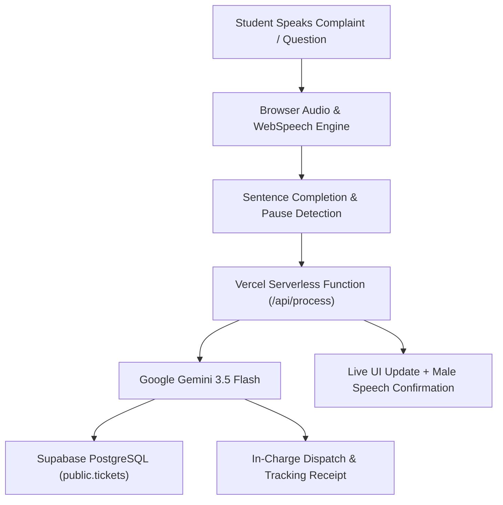

# CampusVoice AI 🎙️🏛️
### *Voice-First AI Campus Assistant & Automated Grievance Desk*

[](https://campusvoice-ai-gules.vercel.app)
[](https://react.dev/)
[](https://aistudio.google.com/)
[](https://supabase.com/)
[](LICENSE)

**Speak. Understand. Act.**  
CampusVoice AI is a voice-first intelligent assistant built for university students. Speak natural complaints or academic queries into the browser; Gemini 3.5 understands your speech verbatim, resolves semester doubts, and automatically registers structured tickets routed to official campus in-charges with instant email receipt generation.

---

## 🌟 Key Features

- **🎙️ Real-Time Voice Activity & Streaming Speech Recognition**
  - Live verbatim word-for-word speech transcription displayed on screen as you speak.
  - Intelligent pause and sentence-end detection with automatic submission — no need to tap stop.
  - Transient noise filter to eliminate mouse click / trackpad tap interference.

- **🧠 Google Gemini 3.5 Intelligence**
  - Multimodal 2-stage audio speech-to-text pipeline.
  - Automatic categorization across Maintenance, Cleanliness, IT, Hostel, Academic, Library, and Safety.
  - Priority triage (High / Medium / Low) with immediate escalation for exams or hazards.
  - Comprehensive Academic Guidance: Answers questions on semester rules, 75% attendance policy, grading scales, and syllabus.

- **🛡️ 24/7 Confidential Anti-Ragging & Bullying Safety Desk**
  - Instant zero-tolerance detection for distress, ragging, or safety concerns.
  - Immediate routing to Chief Security Officer Capt. Vikram Singh and confidential welfare helpline (`1800-180-5522`).

- **🏛️ Department In-Charge Routing & Receipts**
  - Automatically matches and dispatches tickets to specific campus authorities:
    - **Facilities & Maintenance:** Rajesh Verma (`facilities.incharge@campusvoice.edu`)
    - **Housekeeping & Sanitation:** Sunil Patil (`housekeeping.incharge@campusvoice.edu`)
    - **IT & Wi-Fi:** Prof. Anita Sharma (`it.incharge@campusvoice.edu`)
    - **Hostel & Mess:** Dr. K. Ramanathan (`hostel.warden@campusvoice.edu`)
    - **Central Library:** Dr. Meera Sen (`library.incharge@campusvoice.edu`)
    - **Academic Affairs:** Dean Dr. Sanjeev Kapoor (`academics.incharge@campusvoice.edu`)
  - Floating top receipt banner with a smooth 7-second vanishing timer and tracking links.

- **🔊 Confident Male Voice Synthesis**
  - High-clarity, professional voice responses via Web SpeechSynthesis with pitch and cadence tuning.

- **🌐 Multi-Lingual Support**
  - Native language handling for English, Hindi (हिन्दी / Hinglish), and Gujarati (ગુજરાતી).

- **⚡ Cloud Database Persistence with Supabase**
  - Real-time PostgreSQL ticket persistence, ticket search, and status tracking (`Open` ➔ `In Progress` ➔ `Resolved`).
  - Seamless automatic fallback for missing schema columns.

---

## 🚀 Live Demo

- **Production URL:** [https://campusvoice-ai-gules.vercel.app](https://campusvoice-ai-gules.vercel.app)
- **Supported Browsers:** Google Chrome, Microsoft Edge, Brave, Safari, Firefox.

---

## 🏗️ Architecture & Workflow



---

## 🛠️ Tech Stack

| Layer | Technology |
| :--- | :--- |
| **Frontend Framework** | React 19, Vite 6 |
| **Styling & Icons** | Vanilla CSS3 (Custom Apple/Siri Glassmorphic Theme), Lucide React |
| **AI / LLM** | Google Gemini 3.5 Flash via Google Generative AI REST API |
| **Audio & Speech** | Web Speech API, Web Audio Analyser, MediaStream Recording API |
| **Speech Output** | Web SpeechSynthesis API (Tuned Natural Male Voices) |
| **Backend API** | Vercel Serverless Functions (Node.js ES Modules) |
| **Database** | Supabase (PostgreSQL with Row Level Security) |
| **Deployment** | Vercel Edge Network |

---

## 💻 Local Setup & Development

### Prerequisites
- Node.js 20+
- A Google Gemini API key ([aistudio.google.com/apikey](https://aistudio.google.com/apikey))
- A Supabase Project ([supabase.com](https://supabase.com))

### 1. Clone the repository
```bash
git clone https://github.com/nikhilpitrodanc/CampusVoice-AI.git
cd CampusVoice-AI
```

### 2. Install dependencies
```bash
npm install
```

### 3. Configure Environment Variables
Copy `.env.example` to `.env`:
```bash
cp .env.example .env
```
Fill in your credentials:
```env
GEMINI_API_KEY=your_gemini_api_key_here
GEMINI_MODEL=gemini-3.5-flash
SUPABASE_URL=https://your-project.supabase.co
SUPABASE_SERVICE_ROLE_KEY=your_supabase_secret_key_here
```

### 4. Database Setup (Supabase)
Run the script in [`db/schema.sql`](db/schema.sql) in your Supabase SQL Editor:
```sql
create extension if not exists pgcrypto;
create table if not exists public.tickets (
  id uuid primary key default gen_random_uuid(),
  ticket_number bigint generated by default as identity unique,
  category text not null check (category in ('maintenance','cleanliness','it','hostel','library','academic','safety','other')),
  department text not null,
  location text not null,
  description text not null,
  raw_text text,
  priority text not null default 'medium' check (priority in ('low','medium','high')),
  status text not null default 'open' check (status in ('open','in_progress','resolved')),
  student_email text,
  incharge_name text,
  incharge_role text,
  incharge_email text,
  incharge_phone text,
  incharge_office text,
  created_at timestamptz not null default now()
);
alter table public.tickets enable row level security;
```

### 5. Start Development Server
```bash
npm run dev
```
Open `http://localhost:5173` in your browser.

### 6. Run Test Suite
```bash
npm test
```

---

## 🚢 Deployment to Vercel

1. Import your GitHub repository in [vercel.com/new](https://vercel.com/new).
2. Choose **Vite** as the framework preset.
3. In **Environment Variables**, provide:
   - `GEMINI_API_KEY`
   - `GEMINI_MODEL` (`gemini-3.5-flash`)
   - `SUPABASE_URL`
   - `SUPABASE_SERVICE_ROLE_KEY`
4. Click **Deploy**.

---

## 📄 License

This project is licensed under the [MIT License](LICENSE) — see the [LICENSE](LICENSE) file for details.

Developed with ❤️ by **Nikhil Pitroda**.
